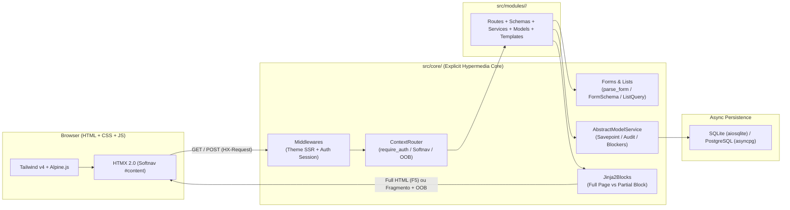

<div align="center">

# `fasthtmx` — Explicit Async Hypermedia Architecture


**HTML + CSS + JS as God intended.**
Arquitetura explícita, enxuta e 100% assíncrona para aplicações web hipermídia sobre **FastAPI + HTMX + Jinja2 Fragments + SQLAlchemy 2.0 Async + Tailwind CSS v4 + Alpine.js**, sem meta-frameworks caixa-preta.

</div>

---

## 1. Motivação e Problemas Resolvidos

- **Problema: Abstrações mágicas ou SPAs pesadas demais.** Frameworks que tentam gerar HTML a partir de componentes Python escondem o DOM, dificultam a estilização com Tailwind e viram um gargalo quando um formulário ou layout foge do básico. No extremo oposto, usar FastAPI + Jinja2 "cru" gera repetição constante em todas as rotas (`if request.headers.get("HX-Request")`, parsing manual de `request.form()`, paginação repetitiva e quebra de layout ao dar `F5` em sub-rotas HTMX).
- **Solução: Facilitadores explícitos no `src/core/`, regras de negócio limpas no `src/modules/`.** Você escreve HTML/Tailwind real e declara rotas FastAPI explícitas, enquanto o `src/core/` resolve a infraestrutura:
  - **Softnav & Subpages resilientes a `F5`**: O `ContextRouter` + `jinja2-fragments` decidem automaticamente entre renderizar a página inteira (acesso direto / `F5`) ou apenas o bloco parcial (`#content` ou `#subpage-card` em `HX-Request`), com suporte nativo a múltiplos blocos `hx-swap-oob` (`oob_blocks`) e eventos `HX-Trigger` (`triggers`).
  - **Segurança por padrão (`require_auth = True`)**: Toda rota do `ContextRouter` exige sessão autenticada por padrão — impossível esquecer `Depends(get_current_user)` em rotas internas. Rotas públicas são declaradas explicitamente com `@route.get("/rota", public=True)` (com suporte opcional a sessões *guest*).
  - **Formulários explícitos (`parse_form` + `FormSchema`)**: Suporte automático a `form.getlist()` para campos `list[...]` (multi-checkboxes e multi-selects), coerção nativa de formatos brasileiros (`BRLDecimal`, `CleanDigits`, `HtmlCheckbox`, `OptionalStr`), tradução automática de erros do Pydantic v2 para **pt-BR** e resposta `422` pronta via `self.form_error_response()`.
  - **CRUD Assíncrono com Savepoints, Auditoria e Bloqueadores**: `AbstractModelService` com *savepoints* (`begin_nested()`), conversão de `IntegrityError` em `UniqueViolation` amigável, *soft delete* com checagem de vínculos (`DeletionBlockedError` + `build_blocker_html` escapado contra XSS) e trilha de auditoria JSON (`audit_logs`).
  - **Núcleo Sincronizável (`fasthtmx core sync`)**: O `src/core/` permanece dentro do projeto para evolução rápida e sem burocracia de pacotes externos, mas sincroniza com um único comando para todos os repositórios derivados.

Detalhes de padrões avançados e templates: [`docs/PATTERNS.md`](docs/PATTERNS.md).

---

## 2. Arquitetura Geral

### Ciclo de Vida de uma Requisição (SSR + Softnav HTMX)

```text
Browser ──GET/POST──▶ ThemeMiddleware (SSR cookie/header)
                   ──▶ SessionMiddleware (JWT HttpOnly + DB auth_sessions c/ throttle 5min)
                   ──▶ ContextRouter (require_auth=True por padrão | public=True)
                         ├── parse_form(request, Schema) / Depends(list_query_params)
                         ├── AbstractModelService (AsyncSession + Savepoint + AuditLog)
                         └── Jinja2Blocks
                               ├── Acesso direto / F5 ──▶ Página completa (base_shell.html)
                               └── HX-Request: true   ──▶ Bloco parcial (#content / #subpage-card)
                                                          + oob_blocks (hx-swap-oob)
                                                          + Header HX-Trigger (toast / closeModal)
```



---

## 3. Anatomia do `src/core/`

| Camada | Componente | Caminho no Repo | Responsabilidade |
| :--- | :--- | :--- | :--- |
| **Roteamento & HTMX** | `ContextRouter` / `@route` | `src/core/router/context_router.py` | Auth-by-default (`require_auth=True`), `dynamic_template_response`, `list_response`, `subpage_response`, `form_error_response`, `oob_blocks` e `HX-Trigger`. |
| **Formulários** | `parse_form` / `FormResult` | `src/core/forms.py` | Extração automática de `getlist()` para listas, validação Pydantic v2 com mensagens em pt-BR e exceção `FormError`. |
| **Coerção de Tipos** | `FormSchema` & Anotações | `src/core/schema.py` | `BRLDecimal` (`"R$ 1.234,56"` -> `Decimal`), `CleanDigits` (CPF/CNPJ/CEP), `HtmlCheckbox`, `OptionalStr`, `OptionalInt`, `OptionalDate`. |
| **Listagens & Tabelas** | `ListQuery` / `ListResult` | `src/core/lists.py` | Paginação, ordenação por coluna (`sort`/`dir`), busca textual (`?q=`) e metadados prontos para as macros de tabela. |
| **Serviços & ORM** | `AbstractModelService` | `src/core/services/model_service.py` | CRUD async com `db.begin_nested()`, *soft delete*, verificação de bloqueadores (`DeletionBlockedError`), `UniqueViolation` e gravação em `audit_logs`. |
| **Banco de Dados** | `DatabaseSessionManager` | `src/core/database.py` | Gerenciador assíncrono (`SQLAlchemy 2.0`) compatível com SQLite (`aiosqlite` com `PRAGMA foreign_keys=ON`) e PostgreSQL (`asyncpg`). |
| **Autenticação & RBAC** | Módulo `auth` + `PermissionVerify` | `src/core/modules/auth/` | Login local (Argon2 em `asyncio.to_thread`) ou LDAP opcional, sessões revogáveis no banco (`auth_sessions`) e controle de grupos/permissões. |
| **Tempo Real (SSE)** | `Notifier` | `src/core/notifications/notifier.py` | Fan-out de notificações em tempo real via Server-Sent Events (em memória ou Redis Pub/Sub). |
| **Templates Base** | `base_shell.html` & Macros | `src/core/templates/` | Shell HTML livre de FOUC de tema e macros reutilizáveis (`macros/forms.html`, `macros/list.html`, `macros/ui.html`, `macros/subpage.html`). |
| **CLI & Sync** | `fasthtmx` CLI | `cli/` | Servidor `dev` integrado, scaffolding de módulos (`module create`), migrações (`db`), usuários (`user`) e sync multi-repo (`core sync`). |

---

## 4. Estrutura do Repositório

```text
fasthtmx/
├── cli/                                    # CLI oficial (`uv run fasthtmx ...`)
│   ├── main.py                             # Comandos: dev, db, user, module, core
│   ├── scaffold.py                         # Gerador de módulos (`module create <slug>`)
│   └── core_sync.py                        # Sincronizador do `src/core/` entre repositórios
├── docs/
│   └── PATTERNS.md                         # Guia de templates, macros, migrações e customização
├── scripts/
│   └── default_seed.py                     # Seed automático de grupos, superadmin e dados demo
├── src/
│   ├── app.py                              # Entrypoint FastAPI, lifespan e handlers 401/403/500
│   ├── core/                               # Núcleo agnóstico do framework (sincronizável)
│   │   ├── database.py                     # Engine/Session async (SQLite / PostgreSQL)
│   │   ├── forms.py                        # `parse_form()`, `FormResult`, `FormError`
│   │   ├── lists.py                        # `ListQuery`, `ListResult`, `list_query_params`
│   │   ├── schema.py                       # `FormSchema`, `BRLDecimal`, `CleanDigits`, `HtmlCheckbox`
│   │   ├── router/                         # `ContextRouter` + `@route.get/post/put/patch/delete`
│   │   ├── services/                       # `AbstractModelService` (savepoints, audit, blockers)
│   │   ├── utils/blockers.py               # `build_blocker_html()` escapado contra XSS
│   │   ├── modules/                        # Módulos nativos: `auth`, `user`, `notifications`, `theme`
│   │   └── templates/                      # `core/base_shell.html` e `macros/*.html`
│   ├── modules/                            # Módulos de negócio da aplicação
│   │   ├── home/                           # Playground de arquitetura, macros e validação
│   │   └── projetos/                       # Showcase completo (CRUD + Subpages + Blockers)
│   ├── templates/                          # Layout (`layout/template.html`), sidebar e overrides
│   └── static/                             # CSS (Tailwind v4) e JS (HTMX + Alpine + componentes)
└── tests/
    └── test_core_lab.py                    # Testes integrados do core e dos módulos de referência
```

---

## 5. Bootstrap e Execução Rápida

### Pré-requisitos
- **Python 3.12+** e [`uv`](https://docs.astral.sh/uv/)
- **Node.js 20+** e [`pnpm`](https://pnpm.io/) (build do Tailwind CSS v4 + bundle JS via `esbuild`)

### Subindo em Modo Desenvolvimento (Zero-Config SQLite)

Por padrão, o projeto roda imediatamente com **SQLite assíncrono (`aiosqlite`)**, criando o schema e o seed inicial automaticamente no startup:

```bash
# 1. Instalar dependências Python e Node
uv sync
pnpm install

# 2. Compilar assets (CSS Tailwind v4 + JS bundle)
pnpm run build:dev

# 3. Iniciar servidor de desenvolvimento (FastAPI + watchers de CSS/JS)
uv run fasthtmx dev
```

Acesse **`http://localhost:8000`** com as credenciais padrão de desenvolvimento:

| Perfil | Usuário / E-mail | Senha | Permissões |
| :--- | :--- | :--- | :--- |
| **Superadmin** | `ti@scc.com.br` ou `superadmin` | `lfw-lala` | `root`, `admin`, `user` |

---

## 6. Receitas Práticas (Uso Diário)

### 6.1. Gerar um Novo Módulo (`fasthtmx module create`)

Cria toda a estrutura padronizada (`models/`, `schemas.py`, `services.py`, `routes/`, `templates/`) já integrada ao Softnav:

```bash
uv run fasthtmx module create contratos --title "Contratos" --with-subpages
```

### 6.2. Declarar Formulários com `FormSchema` e `parse_form`

Sem geração mágica de HTML: escreva seu formulário Tailwind normalmente e valide no backend com tipos brasileiros prontos:

```python
from decimal import Decimal
from core.schema import BRLDecimal, CleanDigits, FormSchema, HtmlCheckbox, OptionalStr


class ProjetoFormSchema(FormSchema):
    codigo: str
    nome: str
    cnpj_cliente: CleanDigits               # "12.345.678/0001-90" -> "12345678000190"
    orcamento_brl: BRLDecimal = Decimal("0") # "R$ 185.400,50"     -> Decimal("185400.50")
    prioritario: HtmlCheckbox = False        # "on" / ausente      -> True / False
    descricao: OptionalStr = None            # ""                  -> None
    tags: list[str] = []                     # Extraído via form.getlist("tags")
```

### 6.3. Rotas Explícitas com `ContextRouter` (Listagem, Subpages e Erros de Form)

```python
from fastapi import Depends, Request
from core.deps import DBSessionDep
from core.forms import parse_form
from core.lists import ListQuery, list_query_params
from core.router import ContextRouter, route


class ProjetosRouter(ContextRouter):
    prefix = "/projetos"
    tags = ["Projetos"]
    # require_auth = True já é o padrão em todo ContextRouter!

    @route.get("/list")
    async def list_view(
        self,
        request: Request,
        db: DBSessionDep,
        query: ListQuery = Depends(list_query_params),
    ):
        service = ProjetoService(db)
        result = await service.list_paginated(query)
        return self.list_response(
            request,
            "projetos/list.html",
            result,
            data_url="/projetos/list",
        )

    @route.post("/create")
    async def create_submit(self, request: Request, db: DBSessionDep):
        form = await parse_form(request, ProjetoFormSchema)
        if not form.is_valid:
            return self.form_error_response(
                request,
                "projetos/create.html",
                errors=form.errors,
                values=form.raw,
            )
        await ProjetoService(db).create_from_schema(form.data)
        return self.redirect("/projetos/list")

    @route.get("/{item_id}/subpage/{tab_name}")
    async def subpage_tab(self, request: Request, item_id: int, tab_name: str, db: DBSessionDep):
        projeto = await ProjetoService(db).get_by_id(item_id)
        # Funciona tanto no clique HTMX (#subpage-card) quanto dando F5 direto na URL da aba!
        return self.subpage_response(
            request,
            parent_template="projetos/view.html",
            subpage_template=f"projetos/subpage/{tab_name}.html",
            context={"projeto": projeto, "active_tab": tab_name},
        )
```

### 6.4. Sincronizar o `src/core/` com Projetos Derivados

Quando você evolui qualquer utilitário dentro de `src/core/` ou `cli/` no `fasthtmx`, propague para os outros repositórios da organização com um comando:

```bash
# Visualizar o que mudaria em todos os projetos irmãos (dry-run)
uv run fasthtmx core sync --dry-run

# Aplicar sincronização em todos os projetos irmãos ou em um caminho específico
uv run fasthtmx core sync
uv run fasthtmx core sync ../gestao-torres
```

---

## 7. Módulos de Referência Inclusos

O repositório acompanha dois módulos completos em [`src/modules/`](src/modules) para servir como referência viva:

1. **`/home` (`src/modules/home/`)**:
   - Playground interativo com abas Softnav (`arquitetura`, `macros`, `status`) e laboratório de validação de formulários ao vivo.
2. **`/projetos/list` (`src/modules/projetos/`)**:
   - **Listagem (`GET /projetos/list`)**: Busca textual (`?q=`), ordenação por coluna (`codigo`, `nome`, `orcamento_brl`, `status`) e paginação parcial (`#table-paged`).
   - **Criação (`GET/POST /projetos/create`)**: Demonstração prática de `BRLDecimal`, `HtmlCheckbox`, `OptionalStr` e múltiplos checkboxes (`tags: list[str]`).
   - **Detalhes + Subpages (`GET /projetos/{id}/view` e `/subpage/{tab}`)**: Layout em 2 colunas com sub-rotas HTMX (`tarefas` e `arquitetura`) que suportam adição/conclusão de tarefas, atualização simultânea de contadores via `oob_blocks` e `F5` direto na URL da aba.
   - **Bloqueio de Exclusão (`GET /projetos/{id}/blockers` + `DELETE /projetos/{id}`)**: Modal de confirmação que inspeciona vínculos ativos e impede a exclusão enquanto houver tarefas pendentes, renderizando o alerta com `build_blocker_html()`.

---

## 8. Testes Automatizados

```bash
uv run pytest -v
```
